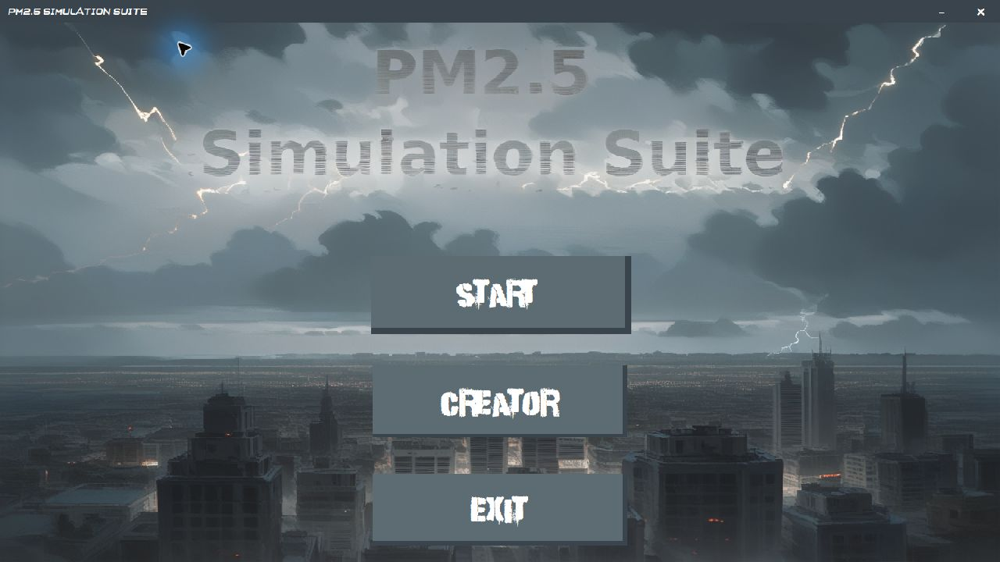
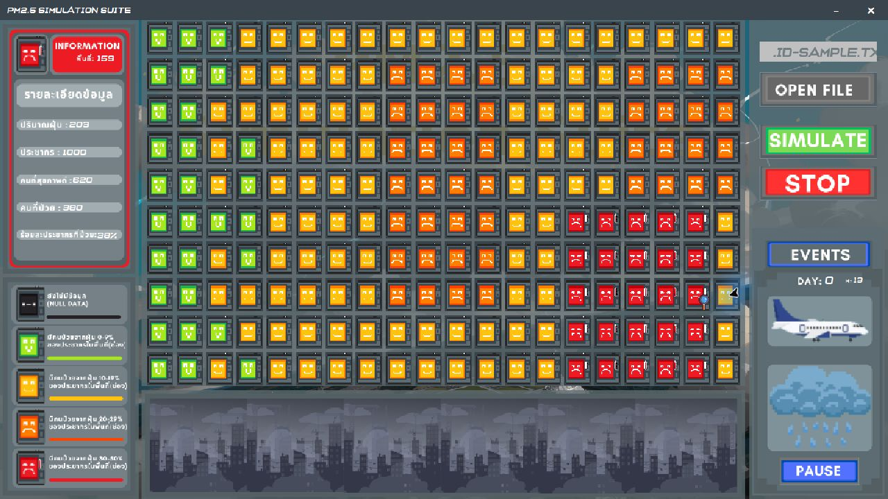
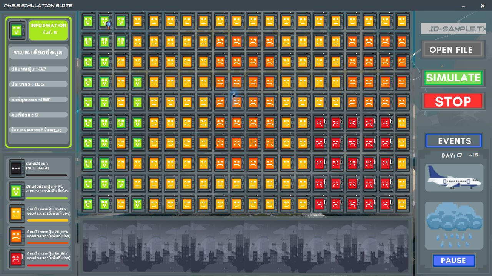
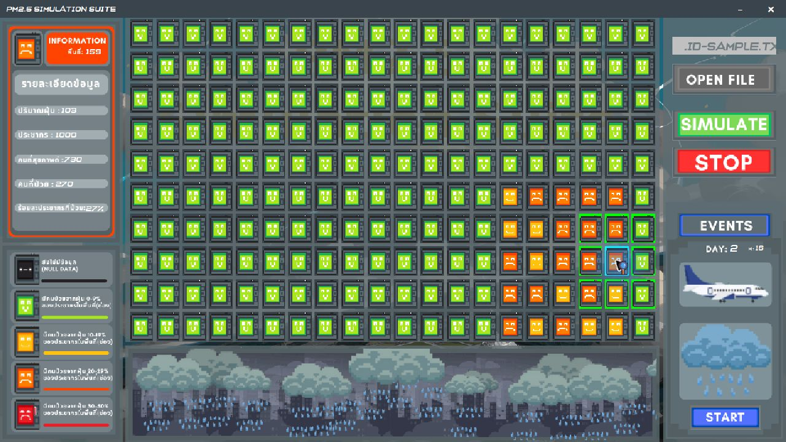

# PM2.5 Simulation Suite

โปรเจกต์รายวิชา **Object-Oriented Programming (OOP) ด้วยภาษา Java** ของนักศึกษาสาขา Computer Science (CS)

โปรแกรม Desktop GUI สำหรับจำลองค่าฝุ่นในแต่ละพื้นที่ แสดงผลเป็นการ์ดสถานีที่มีสีและใบหน้าแตกต่างกันตามระดับฝุ่น สามารถกำหนดประชากร คลิกดูรายละเอียด และทดลองผลของฝนธรรมชาติหรือฝนเทียมต่อค่าฝุ่นได้



## โปรเจกต์นี้ทำอะไรได้บ้าง

- อ่านค่าฝุ่นจากไฟล์ `.txt` และแสดงผลบนตาราง **20 คอลัมน์ × 10 แถว รวม 200 สถานี**
- แสดงสถานะของแต่ละพื้นที่ด้วยสีและใบหน้าบนการ์ด
- คลิกการ์ดเพื่อดูค่าฝุ่น ประชากร จำนวนคนสุขภาพดี จำนวนผู้ป่วย และเปอร์เซ็นต์ผู้ป่วยในแบบจำลอง
- กำหนดประชากรเท่ากันทุกสถานี หรือสุ่มประชากรภายในช่วงที่กำหนด
- จำลองวันและเวลา พร้อมปุ่ม Pause/Start และ Stop เพื่อเริ่มใหม่
- สุ่มเกิดฝนธรรมชาติ และเรียกเหตุการณ์ฝนหรือฝนเทียมด้วยตนเอง

จำนวนผู้ป่วยและคนสุขภาพดีเป็น **ค่าจำลองจากการสุ่มตามเงื่อนไขในโค้ด** เพื่อการเรียนรู้ ไม่ใช่ผลจากข้อมูลสุขภาพจริงหรือแบบจำลองทางการแพทย์

## สิ่งที่ได้ฝึกจากวิชา OOP

| แนวคิด | ตัวอย่างในโปรเจกต์ |
|---|---|
| Class และ Object | แบ่งหน้าที่เป็น `Game`, `GameWindow`, `GamePanel` และ `TimeSystem` |
| Encapsulation | เก็บข้อมูลและ component เป็น field พร้อม method สำหรับจัดการภายในคลาส |
| Inheritance | คลาสหน้าจอสืบทอดจาก `JFrame` และ `JPanel` |
| Method Overriding | วาดพื้นหลังผ่าน `paintComponent()` และกำหนดการทำงานของ event listener |
| Composition | `GameWindow` ประกอบด้วยหน้าจอย่อย และ `GamePanel` ใช้งาน `TimeSystem` |
| Event-driven Programming | รับการกดปุ่ม การคลิกสถานี และเหตุการณ์จาก Swing `Timer` |

## ติดตั้งและรัน

### สิ่งที่ต้องมี

- **JDK 17** สำหรับคอมไพล์และรันจาก source เลือกแพ็กเกจ **JDK / Windows / x64** ได้จาก [Eclipse Temurin](https://adoptium.net/temurin/releases/?version=17&os=windows&arch=x64&package=jdk)
- หน้าจอและระบบ Desktop GUI; ภาพตัวอย่างทดสอบที่ขนาดหน้าต่าง 1280 × 720 บน Windows
- Source code และไฟล์ภาพ/ฟอนต์ของโปรเจกต์ครบทุกโฟลเดอร์

โปรเจกต์ใช้ Java Swing/AWT และไลบรารีมาตรฐานของ Java จึงไม่ต้องติดตั้ง Maven, Gradle หรือไลบรารีภายนอกเพิ่มเติม

### 1. เตรียม source code

ดาวน์โหลด source code ของ repository หรือใช้ `git clone` เมื่อมี URL ของ repository แล้ว จากนั้นเปิด PowerShell ที่โฟลเดอร์โปรเจกต์ ซึ่งมี `main`, `font` และ `pm2.5.txt` อยู่ข้างกัน

### 2. ตรวจ Java

```powershell
java -version
javac -version
Get-Command java, javac
```

ตรวจว่า `java` และ `javac` ชี้ไป JDK รุ่นเดียวกัน หากไม่พบคำสั่ง ให้ตรวจการติดตั้ง JDK และ PATH แล้วเปิด terminal ใหม่

### 3. คอมไพล์

รันจากโฟลเดอร์หลักของโปรเจกต์:

```powershell
New-Item -ItemType Directory -Force .\build\classes | Out-Null
$sources = Get-ChildItem -Path .\main\*.java, .\font\*.java -File |
    Select-Object -ExpandProperty FullName
javac -encoding UTF-8 -d .\build\classes @sources
```

ใช้ `UTF-8` เพื่ออ่านโค้ดและ comment ภาษาไทยให้ถูกต้อง ไฟล์ `.class` ที่ได้จะอยู่ใน `build/classes` แยกจาก source เดิม

### 4. เปิดโปรแกรม

```powershell
java -cp "build\classes;." main.MainClass
```

คำสั่งนี้ใช้สำหรับ **Windows PowerShell** โดยต้องรันจากโฟลเดอร์หลักของโปรเจกต์ จุด `.` ใน classpath ทำให้โปรแกรมหาไฟล์ภาพและฟอนต์จากโฟลเดอร์เดิมได้

ตัว repository เก็บ source และ resource เป็นหลัก ไม่จำเป็นต้องมี `.exe`, `.jar` หรือ JRE แนบมาเพื่อทำตามขั้นตอนนี้

## ตัวอย่างการใช้งาน

### จำลองจากไฟล์ตัวอย่าง

1. เปิดโปรแกรมแล้วกด **START**
2. กด **OPEN FILE** แล้วเลือก `pm2.5.txt` ในโฟลเดอร์โปรเจกต์
3. กด **SIMULATE**
4. ใส่ประชากร เช่น `1000` แล้วกดปุ่มยืนยัน ทุกสถานีที่มีข้อมูลจะใช้ประชากรค่านี้
5. คลิกการ์ดสถานีเพื่อดูรายละเอียดด้านซ้าย
6. กด **PAUSE** เพื่อหยุดนาฬิกา หรือ **STOP** เพื่อล้างการจำลองและเริ่มใหม่



สีและจำนวนผู้ป่วยอาจต่างจากภาพเมื่อทดลองเอง เนื่องจากมีการสุ่มและเหตุการณ์ฝนระหว่างที่เวลาเดิน

### สุ่มประชากรแบบช่วง

หลังเลือกไฟล์และกด **SIMULATE** ให้เลือกปุ่มสุ่มประชากร แล้วกำหนดค่าต่ำสุด เช่น `100` และค่าสูงสุด `200` โปรแกรมจะสุ่มประชากรให้แต่ละสถานีภายในช่วงนั้น



### ทดลองฝนและฝนเทียม

- **ฝนธรรมชาติ:** เกิดแบบสุ่มเมื่อเวลาเดิน หรือกดปุ่มรูปฝนขณะ Pause ค่าฝุ่นในช่วงที่โปรแกรมรองรับจะลดลง 50 และไม่ต่ำกว่า 0
- **ฝนเทียม:** กดปุ่มรูปเครื่องบิน แล้วเลือกสถานีเป้าหมาย จะไฮไลต์พื้นที่บริเวณ 3 × 3 รอบจุดที่เลือก หลังเหตุการณ์จบ ค่าฝุ่นเป้าหมายลดลง 50% และสถานีข้างเคียงลดลง 30% สำหรับค่าที่โปรแกรมรองรับ
- หากเลือกสถานีริมตาราง พื้นที่ข้างเคียงจะมีเฉพาะตำแหน่งที่อยู่ภายในตาราง
- เวลาในแบบจำลองเดินประมาณ **1 ชั่วโมงต่อ 0.5 วินาทีจริง** และครบ 24 ชั่วโมงเป็น 1 วัน



**Pause หยุดนาฬิกาจำลอง** แต่เหตุการณ์หรือ animation ที่เริ่มไปแล้วอาจทำงานต่อ และสามารถเรียกฝนระหว่าง Pause ได้ตามพฤติกรรมปัจจุบัน

## รูปแบบไฟล์ข้อมูลฝุ่น

ใช้ไฟล์ `.txt` ที่มีเฉพาะตัวเลข คั่นด้วยช่องว่าง แท็บ หรือขึ้นบรรทัดใหม่ ไม่มีหัวตาราง ชื่อสถานี หรือเครื่องหมาย comma

ตัวอย่างรูปแบบข้อมูล 12 สถานี:

```text
10 45 65 90
130 180 200 75
50 100 150 220
```

โปรแกรมอ่านค่าตามลำดับจากซ้ายไปขวา แล้วต่อแถวถัดไป การขึ้นบรรทัดในไฟล์ใช้คั่นข้อมูล ไม่ได้กำหนดแถวของหน้าจอ ตารางหน้าจอมี 20 คอลัมน์คงที่ ส่วน `pm2.5.txt` ที่แนบมาเป็นตัวอย่างเต็ม 200 สถานี

สำหรับรุ่นปัจจุบัน แนะนำใช้ **ไฟล์ไม่ว่าง จำนวน 1–200 ค่า และเป็นจำนวนเต็มระหว่าง 0–250** เพื่อหลีกเลี่ยงข้อจำกัดที่ระบุด้านล่าง

| ค่าฝุ่นในแบบจำลอง | สีสถานะ |
|---|---|
| 0–50 | เขียว |
| 51–100 | เหลือง |
| 101–150 | ส้ม |
| 151–250 | แดง |

## โครงสร้างโปรเจกต์

```text
PM25-Simulation-Suite/
├── main/             # หน้าจอ การจำลอง การรับข้อมูล และระบบเวลา
├── font/             # SetFont.java และไฟล์ฟอนต์
├── button/           # ภาพปุ่มควบคุม
├── Creator/          # ภาพประกอบหน้าผู้จัดทำ
├── Event/            # ภาพและ animation ของเหตุการณ์
├── image/            # พื้นหลัง การ์ด และภาพสถานะ
├── mouse/            # ภาพ cursor
├── pm2.5.txt         # ข้อมูลตัวอย่าง
├── docs/screenshots/ # ภาพตัวอย่างการใช้งาน
└── README.md
```

จุดเริ่มต้นโปรแกรมคือ `main/MainClass.java` ส่วนตรรกะการจำลองหลักอยู่ใน `main/GamePanel.java` และระบบเวลาอยู่ใน `main/TimeSystem.java`

## สถานะและข้อจำกัดที่ทราบ

โปรเจกต์นี้เป็นงานเพื่อการเรียนรู้และยังมีจุดที่สามารถพัฒนาต่อได้:

- ไฟล์ว่างยังถูกยอมรับและแสดงเป็น 1 สถานีที่มีค่าฝุ่น 0
- ค่าทศนิยมบางช่วง เช่น `50.5`, `100.5` และ `150.5` ไม่มีสถานะ เพราะเงื่อนไขช่วงยังมีช่องว่าง รวมถึงค่าทศนิยมที่เกิดหลังเหตุการณ์ฝนเทียม
- `NaN` และ `Infinity` ยังไม่ถูกปฏิเสธ และข้อมูลเกิน 200 ค่าสามารถทำให้เกิด exception ระหว่างอัปเดตตารางได้
- การทำงานต่อเนื่องระยะยาวของ timer/cooldown และการแสดงผลบน DPI/ขนาดจออื่นยังต้องทดสอบเพิ่ม

คอมไพล์ source ปัจจุบันผ่านด้วย **JDK 17.0.17 และ 22.0.2** และทดลอง GUI ด้วย **Java 22.0.2 บน Windows** แล้วในเส้นทางนำเข้าข้อมูล ประชากรคงที่/แบบช่วง รายละเอียดสถานี เวลา ฝน ฝนเทียม และ Stop/เริ่มใหม่ ภาพใน README มาจากโปรแกรมจริง

## ถ้าเปิดไม่ขึ้น

- **ไม่พบ `javac`:** ต้องติดตั้ง JDK และให้ terminal มองเห็นคำสั่ง ไม่ใช่มีเฉพาะ runtime
- **หา `main.MainClass` ไม่เจอ:** คอมไพล์ให้สำเร็จก่อน และรันจากโฟลเดอร์หลักด้วย classpath ตามตัวอย่าง
- **ภาพ/ฟอนต์หาย หรือเกิดข้อผิดพลาดตอนเปิดหน้าจอ:** ตรวจว่าโฟลเดอร์ resource อยู่ครบ และมี `;.` ต่อท้าย classpath บน Windows
- **เปิด `.txt` ไม่ได้:** ใช้ข้อมูลตัวเลขล้วน ลอง `pm2.5.txt` ที่แนบมาก่อน
